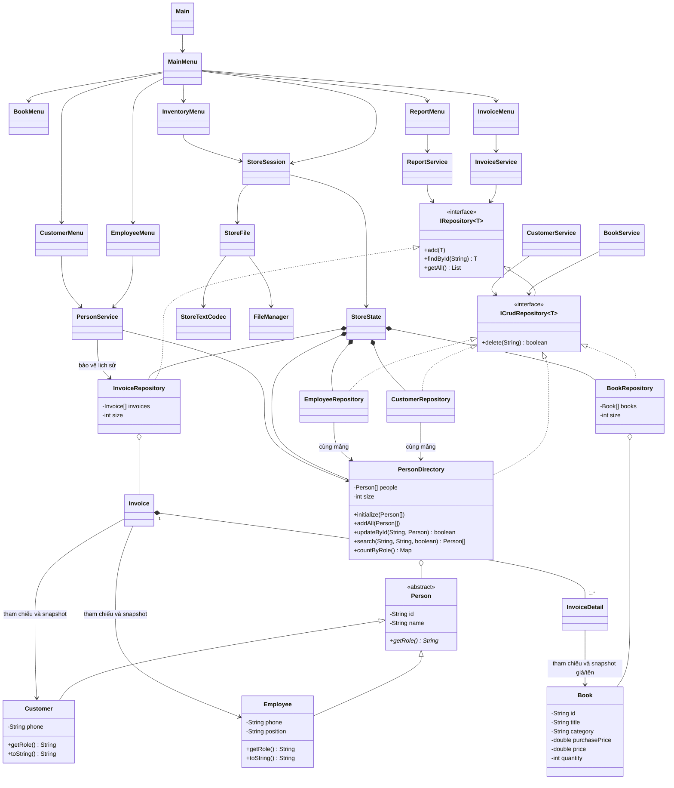

# Sơ đồ lớp BookStoreManagement

Sơ đồ tập trung vào các quan hệ nghiệp vụ và OOP chính. Các lớp giao diện gọi service; `StoreSession` phối hợp lưu toàn bộ trạng thái sau mỗi lệnh thay đổi.

Các mảng `Person[]`, `Book[]`, `Invoice[]` tự tăng kích thước bằng `Arrays.copyOf`; xóa phần tử dồn các phần tử còn lại. `List` trả về từ repository là bản sao; không thay thế mảng lưu trữ chính. Chi tiết hóa đơn vẫn dùng danh sách bất biến từ phía người gọi, theo API hiện có.

Đa hình được gọi thật: `PersonDirectory.search`, `countByRole`, `PersonService.initializeRole` và màn hình danh sách nhân viên gọi `getRole()` qua biến `Person`; khi in đối tượng qua `Person`, Java chọn `toString()` của lớp con.

`PersonMenu` và constructor/API cũ được giữ để các bài kiểm tra và ví dụ thao tác mảng hiện có tiếp tục dùng. Ứng dụng thực tế khởi động qua `Main.main → runInteractive`, với menu khách hàng và nhân viên riêng.
