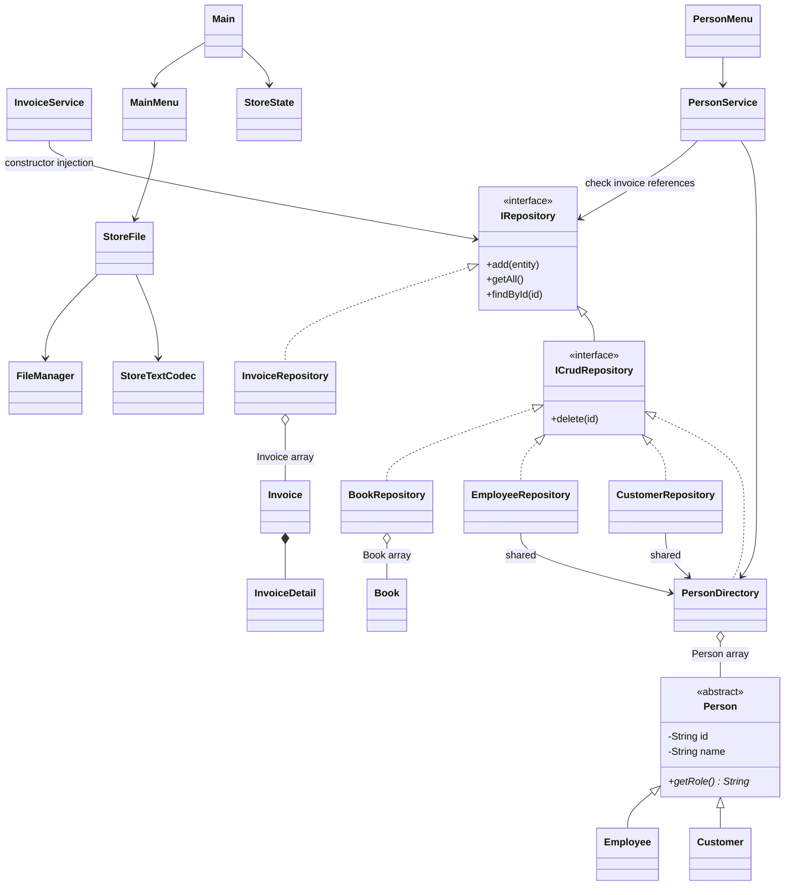

# Bàn giao phần Minh Trí — bản mẫu Leader

## Phạm vi đã thực hiện

Phần Leader gồm Person abstract, hợp đồng repository, danh sách mảng dùng chung, wiring Main/MainMenu/StoreConfig, checkout InvoiceService, tích hợp lưu/nạp snapshot text, kiểm tra OOP và kịch bản demo. PersonService/PersonMenu là mẫu hoàn chỉnh để các bạn học cách nối model → danh sách → service → menu; không thay yêu cầu mỗi bạn hiểu và phát triển module của mình.

Mã hiện có 29 public class trong src, không tính interface, test hoặc lớp Row nội bộ. Mỗi class có constructor viết rõ, kể cả constructor private cho utility và Main. Không tạo class rỗng để đủ số lượng. Có thể kiểm tra lại khi nhóm thêm/bớt lớp:

```powershell
(Get-ChildItem src -Recurse -Filter *.java | Select-String '^public (abstract |final )?class ').Count
```

Đề gửi ghi nhóm 4 sinh viên nhưng phân công hiện là 5 người; các mục điểm cộng thành 11. Trí cần xác nhận hai điểm này với giảng viên. Tài liệu không tự sửa tỷ trọng hoặc loại thành viên, cũng không đảm bảo điểm thay cho đánh giá của giảng viên.

## Đối chiếu tiêu chí của thầy

| Tiêu chí | Bằng chứng trong chương trình | Cách demo |
|---|---|---|
| Ít nhất 15 class | 29 public class có trách nhiệm rõ | Mở cây src và kiểm tra số class |
| Constructor | Person, các model, service, repository, menu, StoreState; utility có constructor private | Giải thích constructor injection ở Main |
| Kế thừa hợp lý | Customer extends Person, Employee extends Person | id/name ở lớp cha, phone/position ở lớp con |
| Cài đặt và sử dụng đa hình | PersonDirectory giữ cả hai subtype trong Person[]; PersonMenu gọi getRole/toString; service dùng IRepository | Menu 6 → 1 và 8 |
| Lớp mảng đối tượng | PersonDirectory: Person[] + size; BookRepository: Book[]; InvoiceRepository: Invoice[] | Nhập n, thêm 1/k, sửa/xóa, tìm, thống kê; giải thích dồn mảng |
| Đọc/ghi text | StoreTextCodec, StoreFile, FileManager; nạp ở Main, lưu ở menu 7/0 | Lập hóa đơn, lưu/thoát, mở lại, kiểm tra kho và doanh thu |
| Thuộc tính/phương thức static | StoreConfig có hằng static final và resolveStoreFile; SampleData.create; Main.main | Giải thích hằng dùng chung khác trạng thái instance |
| Abstract class/method | Person và getRole | Không thể new Person; subtype bắt buộc override |
| Interface | IRepository, ICrudRepository và các lớp thực thi | InvoiceService chỉ cần hợp đồng add/getAll/findById |
| Sáng tạo — đề xuất minh họa | Snapshot hóa đơn giữ giá/tên lịch sử; file có VERSION/END; thay snapshot bằng atomic move; giỏ trùng mã được gộp | Đổi tên/giá sau bán, hóa đơn cũ vẫn giữ thông tin; thử thiếu kho nhiều sách |

ArrayList chỉ còn dùng làm kết quả trả về/tập dòng tạm và danh sách detail; dữ liệu trung tâm đã được chứa bằng **mảng đối tượng thật**, không chỉ đổi tên List thành “mảng”.

## Kiến trúc và sơ đồ lớp



Luồng thực tế:

1. Main đọc đường dẫn từ StoreConfig, nạp StoreState hoặc tạo mẫu cho file chưa tồn tại.
2. StoreState tạo một PersonDirectory, truyền cùng instance cho CustomerRepository và EmployeeRepository.
3. Main truyền repository dùng chung cho service; truyền service và một InputHelper cho menu.
4. Menu chỉ nhập/hiển thị; PersonService/InvoiceService giữ nghiệp vụ; repository giữ mảng và kiểm tra mã trùng.
5. MainMenu lưu toàn bộ StoreState bằng một file, không ghi kho và hóa đơn thành hai giao dịch tách rời.

## Hợp đồng chốt để các bạn code tiếp

```java
// Interfaces hiện có
interface IRepository<T> {
    void add(T entity);
    List<T> getAll();
    T findById(String id);
}
interface ICrudRepository<T> extends IRepository<T> {
    boolean delete(String id);
}

// Constructors thực tế — chữ ký tham khảo, không chép dấu ; vào concrete class.
BookService(ICrudRepository<Book> repository)
CustomerService(ICrudRepository<Customer> repository)
PersonService(PersonDirectory people, IRepository<Invoice> invoices)
InvoiceService(IRepository<Invoice> invoices, IRepository<Book> books,
               IRepository<Customer> customers, IRepository<Employee> employees)
ReportService(IRepository<Invoice> invoices)
```

- Mã được trim/uppercase ở model; tìm không phân biệt hoa thường. Customer/Employee chung không gian mã trong PersonDirectory, nên dùng KH... và NV... đúng loại.
- add từ chối null/trùng mã trước khi đổi dữ liệu. findById không có trả null; getAll trả list mới, không phải deep copy các phần tử.
- Constructor/setter model ném IllegalArgumentException nếu chuỗi trống, ký tự phân cách file hoặc giá không hợp lệ. Service sách thêm/sửa giữ kết quả boolean hiện có. Không đổi kiểu trả về tùy ý khi ghép nhánh.
- PersonService.initialize/addAll kiểm tra cả lô trước khi thay mảng. initialize không được chạy khi đã có hóa đơn, danh sách mới phải giữ nhân viên mặc định NV001.
- PersonService.delete không cho xóa NV001 hoặc người đã có hóa đơn. Repository không phụ thuộc nghiệp vụ hóa đơn; module khách khi thêm nút xóa phải dùng quy tắc service này, không gọi thẳng repository.
- updateById giữ mã và loại người. Sau sửa nhân viên, InvoiceMenu lấy lại nhân viên hiện tại qua Supplier nên không giữ đối tượng cũ đã bị thay trong mảng.
- Money vẫn dùng double để giữ API module; đã chặn NaN/Infinity và kết quả không hữu hạn. Chưa chuyển riêng module sang long. Dữ liệu mẫu dùng VND nguyên; tiền lẻ có giới hạn sai số double.
- Nhân viên bán được InvoiceService tra lại từ EmployeeRepository, không tin một Employee tự tạo ở menu.

## Đọc và giải thích từng phần code mẫu

### Person: abstract và kế thừa

Đọc Person trước Customer/Employee. Constructor protected chỉ phục vụ lớp con; id là private final; name dùng setter có validation. Customer gọi super(id, name) rồi gán phone. getRole là abstract ở Person, được override ở hai lớp con. Khi biến kiểu Person trỏ tới Customer, person.getRole chạy bản Customer — đó là đa hình đang được sử dụng.

### PersonDirectory: mảng, size và dồn phần tử

```java
private Person[] people; // Bộ nhớ chứa đối tượng có thể là Customer hoặc Employee.
private int size;        // Số phần tử đang dùng; khác với people.length là sức chứa.

// Khi thêm và mảng đầy:
people = Arrays.copyOf(people, people.length * 2); // Tăng sức chứa, giữ phần tử cũ.
people[size++] = person; // Gán tại ô trống rồi tăng size.

// Khi xóa tại index đã tìm thấy:
for (int i = index; i < size - 1; i++) {
    people[i] = people[i + 1]; // Dồn phần tử phía sau sang trái một ô.
}
people[--size] = null; // Giảm số lượng và bỏ tham chiếu ở ô cuối.
```

Đây là trích đoạn giải thích, không thay thế phần kiểm tra đầu vào trong phương thức thật. Chỉ duyệt từ 0 đến size - 1; không duyệt toàn bộ sức chứa rồi gọi getter trên ô null. toArray trả bản sao để mã bên ngoài không tự gán null vào mảng gốc. Các phần tử vẫn là đối tượng dùng chung, nên cập nhật phải theo service.

addAll tạo candidate, đưa phần tử cũ và phần tử mới vào candidate để kiểm tra mã trùng. Chỉ gán mảng chính sau khi cả lô hợp lệ; đây là lý do một dòng lỗi không làm thêm dở vài người.

### InvoiceService: kiểm tra trước, cập nhật sau

1. Kiểm tra mã hóa đơn chưa có; kiểm tra khách và nhân viên từ repository chính thức.
2. Chuẩn hóa và gộp giỏ theo mã sách; Math.addExact phát hiện tràn int.
3. Tạo hóa đơn nháp; duyệt toàn bộ giỏ để kiểm tra sách/tồn/đơn giá, lưu lượng còn lại vào cấu trúc tạm. Chưa trừ kho.
4. InvoiceDetail chụp giá/tên/mã sách lúc bán, Invoice chụp thông tin khách/nhân viên và ngày.
5. Hoàn tất hóa đơn, thêm vào repository, rồi gán tồn còn lại đã kiểm tra. Repository bộ nhớ hiện tại không ném lỗi sau khi đã thêm.
6. Nếu lỗi trước khi thêm, không đổi kho/hóa đơn. Đây là quy trình một luồng trong bộ nhớ; không được gắn I/O ném lỗi vào giữa mà bỏ qua thiết kế rollback.
7. Lưu bền vững cả phiên bằng menu 7/0. Trước khi lưu, thay đổi chưa được đảm bảo trên đĩa; không tuyên bố tự lưu từng lần bán.

Invoice đã complete không được addDetail; getDetails trả list không sửa được. Khi in hóa đơn, dùng getter snapshot, không lấy tên/giá từ Book hiện tại. Constructor lịch sử của InvoiceDetail nhận historicalTitle và price; StoreTextCodec phục hồi cả hai.

### Lưu file: schema và nguyên tắc mở rộng

Một file UTF-8 có các bản ghi sau, phân cách bằng dấu `|`:

```text
VERSION|1
BOOK|id|title|author|price|quantity
CUSTOMER|id|name|phone
EMPLOYEE|id|name|position
INVOICE|id|customerId|customerName|customerPhone|employeeId|employeeName|employeePosition|yyyy-MM-dd
DETAIL|invoiceId|bookId|historicalTitle|quantity|historicalPrice
END|bookCount|customerCount|employeeCount|invoiceCount|detailCount
```

Mẫu trên là sơ đồ cột, không phải dữ liệu để chạy vì chứa chữ thay số. Dữ liệu thật ở samples/store.txt.

split("\\|", -1) giữ cột rỗng; parser kiểm tra số cột/kiểu/giá/ngày/mã trùng/liên kết detail. VERSION phải hỗ trợ, END phải khớp số bản ghi; footer giúp nhận ra file bị cắt, không phải checksum bảo mật. Nạp vào StoreState mới, chỉ dùng trạng thái đó khi toàn bộ parse thành công.

StoreFile.save ghi nội dung vào file tạm cùng thư mục rồi thay file chính bằng atomic move. Nếu filesystem không hỗ trợ atomic replace, thao tác báo lỗi, không tự fallback sang ghi đè thiếu an toàn. Đây không phải cam kết chống mất điện tuyệt đối hoặc xử lý nhiều ứng dụng cùng ghi; chưa có fsync/lock đa tiến trình.

File chưa tồn tại: seed đúng một lần và lưu. File rỗng/hỏng: từ chối khởi động, không ghi đè. File hợp lệ không có bản ghi: nạp trạng thái rỗng; muốn bán cần thêm nhân viên NV001 và dữ liệu phù hợp qua menu. EOF lưu những thao tác đã hoàn tất; giỏ đang nhập không được bán.

Phú thêm category thì cần phối hợp Trí/Hoàng đổi encode/decode, version hoặc migration, dữ liệu mẫu và kiểm thử trong cùng thay đổi. Không tự thêm cột mà bỏ loader cũ. Hóa đơn có snapshot nên khi danh mục bị xóa, loader vẫn khôi phục lịch sử từ thông tin lưu trữ; không tự tạo lại sách/khách trong danh mục bán hiện tại.

## Các bạn tiếp tục phần nào?

| Thành viên | Phần tiếp tục trên mẫu Leader | Quy tắc phối hợp |
|---|---|---|
| Phú | category, tìm sách theo nhiều trường, hoàn thiện BookMenu/BookService và dữ liệu sách | Giữ constructor cũ bằng overload hoặc sửa toàn bộ nơi gọi; đổi schema cùng Trí/Hoàng |
| Nam | Hoàn thiện CustomerMenu/CustomerService sửa/xóa và phone, trình bày kế thừa/đa hình | Dùng PersonService cho nghiệp vụ xóa; không tạo danh sách khách thứ hai tách khỏi PersonDirectory |
| Long | Lọc ngày, top sách, tìm/xem hóa đơn chi tiết, trình bày báo cáo | ReportService chỉ đọc hóa đơn hoàn tất, dùng snapshot; không trừ kho từ menu |
| Hoàng | Mở rộng nhập liệu/file, bộ dữ liệu demo, kiểm thử môi trường và hướng dẫn chạy | Mẫu lưu/nạp đã tích hợp để tham khảo; không nối ghi từng repository thành nhiều file rời |
| Trí | Review PR, cập nhật hợp đồng/schema, tích hợp module hoàn thiện, chạy toàn bộ kiểm tra và tổng duyệt | Giữ một instance dữ liệu và một luồng checkout; không tự coi mẫu là phần của mọi người đã nghiệm thu |

## Kịch bản demo khoảng 7–10 phút

1. Build chương trình; dùng --data build/demo-store.txt để tránh sửa dữ liệu làm việc.
2. Mở menu 6 → 1: chỉ ra Customer và Employee trong cùng danh sách; chọn 8 để đếm theo getRole.
3. Ở menu 6: thêm k người để vượt sức chứa 4; thử sửa một người, tìm gần đúng theo tên + vai trò, xóa người chưa có hóa đơn. Không dùng nhập mới toàn danh sách nếu chưa muốn xóa mẫu.
4. Quay lại, chọn 3: HD001, KH001, S001, 2, 0. Tổng 300000, tồn S001 còn 18.
5. Thử HD002 với S001 số lượng 999, xác nhận 0: lỗi thiếu kho; kho và doanh thu không đổi.
6. Chọn 1, sửa giá/tên S001; chọn 4: hóa đơn HD001 vẫn giữ tên/giá bán cũ.
7. Chọn 5 xem doanh thu/lượng; chọn 7 hoặc 0; chạy lại cùng file và xem kho/hóa đơn không mất.
8. Mở Person, PersonDirectory.delete, InvoiceService.createInvoice và sơ đồ lớp để trả lời lý thuyết/giải thích code.

Nếu đã có HD001 từ lần demo trước, dùng mã mới hoặc một đường dẫn --data mới chưa tồn tại. Không xóa/reset dữ liệu chung để làm lại demo.

## Câu hỏi và bài gõ lại để luyện bảo vệ

| Câu hỏi của thầy | Nội dung cần hiểu |
|---|---|
| Tại sao Person abstract? | Không có “người” chung được bán/ghi nhận trực tiếp; chia sẻ id/name và bắt buộc vai trò cụ thể |
| Abstract khác interface ở đây thế nào? | Person có trạng thái và constructor; IRepository là hợp đồng thao tác cho các kiểu dữ liệu khác nhau |
| Đa hình thực sự chạy ở đâu? | Vòng lặp Person[] gọi getRole/toString; InvoiceService gọi repository qua interface |
| size khác length thế nào? | size là số ô đang dùng, length là số ô đã cấp phát |
| Tại sao xóa phải dồn? | Mảng trung tâm giữ các phần tử liên tục trong [0,size), không để lỗ null |
| Tại sao không trừ kho lúc nhập giỏ? | Hủy/EOF hoặc một sách thiếu sẽ làm tồn thay đổi dù chưa có giao dịch hợp lệ |
| Sửa giá sách có đổi hóa đơn cũ không? | Không; detail chụp đơn giá tại lúc bán, không đọc giá hiện tại khi cộng tổng |
| static có thay constructor không? | Không; static thuộc lớp, constructor tạo instance. Dữ liệu của phiên vẫn là instance |
| File hỏng xử lý sao? | Báo lỗi, giữ file, không seed đè; parse vào trạng thái tạm |

Bài gõ lại: constructor Customer gọi super; override getRole; tìm theo mã bằng vòng for; xóa và dồn Person[]; tăng sức chứa mảng; tính tổng Invoice; validate thiếu kho trước cập nhật; đọc/ghi một dòng UTF-8. Tự viết lại và giải thích từng dòng, không chỉ học thuộc tên lớp.

## Git, kiểm thử và giới hạn bàn giao

Không tự commit/push/merge khi chưa được Trí yêu cầu. Đề xuất PR riêng cho từng module; mô tả API đổi, cách chạy, ca đúng/sai và việc chưa làm. Trí review chữ ký chung và toàn bộ build trước merge. Runtime data/ và build/ được Git bỏ qua, samples/ được theo dõi làm dữ liệu mẫu.

Chạy scripts/check.ps1 nếu máy cho phép script; README có lệnh trực tiếp khi execution policy chặn. Kiểm tra bao gồm mảng tăng kích thước/dồn phần tử, batch atomic, chia sẻ dữ liệu giữa các view, đa hình, checkout, file round-trip, lỗi file/lỗi lưu, restart, menu, EOF và bảo vệ lịch sử.

Kết quả thực tế ngày 20/10/2026: biên dịch toàn bộ source và hai bộ kiểm tra với javac 27, `--release 17 -Xlint:all`, không có cảnh báo. RegressionChecks đạt 34 kiểm tra, LeaderChecks đạt 64 kiểm tra: tổng **98 kiểm tra đạt**. Đã kiểm tra cả luồng menu thêm k người/sửa/tìm/thống kê/xóa, thay nhân viên rồi bán, lưu và mở lại. Chưa chạy trên JDK 17 thật hoặc máy khác; tổng duyệt nhóm cần làm thêm bước đó. Script bị execution policy của môi trường chặn nên lần này dùng đúng các lệnh biên dịch/chạy trực tiếp trong README.

Giới hạn hiện tại: một tiến trình/một người thao tác, không tự lưu sau mỗi lần bán, chưa xử lý chính xác tuyệt đối tiền lẻ bằng double. Phần Leader tích hợp các chức năng hiện có và cung cấp mẫu trung tâm; category, CRUD khách ở menu riêng và báo cáo nâng cao vẫn là phần phát triển của thành viên theo bảng trên.
